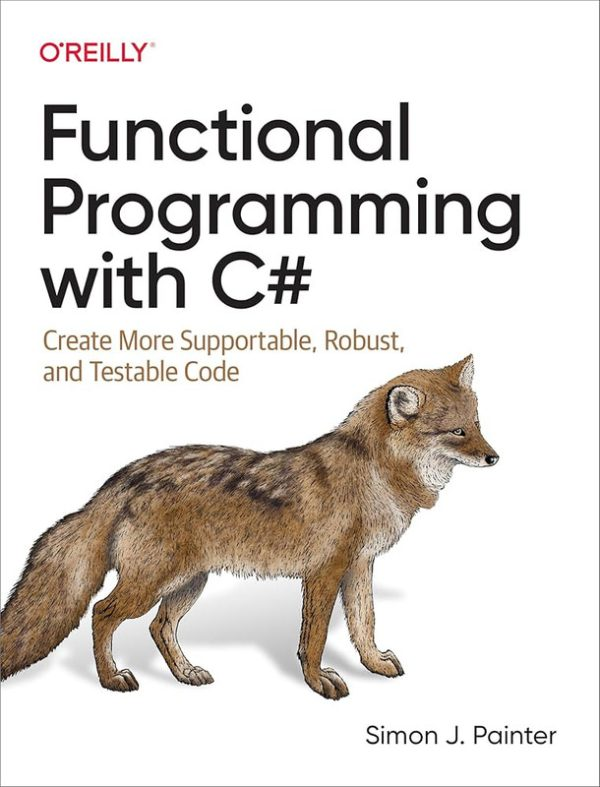

  

		<h2>Functional Programming with C#</h2>
		<h3>The Mondas Were Here the Whole Time!</h3>
        <h4>Done as part of the <a href="https://www.csadvent.christmas/">C# Advent</a></h4>
		

		
	
			

				
			

If you ask most people what a Monad is...actually, bad start.  Most people aren't in IT.  They'd just get confused and ask if you wanted sugar in that coffee or not.  OK, if you ask most developers what a Monad is...you'd likely get a similar reaction, if I'm honest.  Relatively few people know what one is, what you do with it, or why you should care.  But - what if I were to tell you that not only are they useful, not only does C# support them, but they've been in C# for decades already!  Don't believe me?  Well, follow me... 

<h4>What is a Monad?</h4>

Let's addres the monadic elephant in the room first - what is it?  Let me try explaining with a parable.

Imagine you've been handed a device.  It's probably pretty cool.  If you press the button on the side it makes a perfect gingerbread latte with a little gingerbread man next to it.  Delicious.  All you have to do is load the beans in the top <i>just</i> right, and use the correct brand of cream and <i>exactly</i> the right brand of cinammon.  If you don't - it explodes and knocks one of the walls of your house down.  That's bad.

So, what do you do with this thing?  You really, really like gingerbread lattes, but sometimes you don't get everything loaded exactly right.  And for that matter, sometimes your kids pop in to have a go too.  They're young, but they like a latte.  Can you really trust them to get it right?

Here's what you do - you talk to your friend down at bomb disposal.  She's got one of those dome things they pop over a suspicious package which will either contain the explosion, or allow it to make a latte without a problem.  It's a safe environment into which you can pass the device so it can run, then the results can be shown to you, so you can decide whehter to drink them, or pop them in the nearest bin.

You see?

A monad is something that is passed a function which could have all sorts of unforseen consequences when it executes - like an unhandled exception, and allows it to run safely.  Then lets you decide what to with the results.  There are loads of different oness with different purposes.  The Result and Either monads are mostly about trapping unhandled exceptions & preventing them from leaking outside the execution environment.  The Opion or Maybe monad is about trapping nulls, so the null reference exeption does't happen.  There are more too, but these - at least in a C# concept are among the more useful.

<h4>Let's Make a Monad</h4>

Just to show you how it's done, here's one of the simplest and most useful monads you could make.  Result.  It has one input - a function.  It outputs either one of two possible objects - Success (the function worked) or Failure (it exploded and leaked gingerbread powder everywhere).  First thing we need is something to return and for that we need a static class and a bit of inheritance:

<pre>
	<code class="cs hljs">
public interface Result&lt;T&gt; { }
public readonly record struct Success&lt;T&gt;(T Value)  : Result&lt;T&gt;;
public readonly record struct Failure&lt;T&gt;(Exception e): Result&lt;T&gt;;

	</code>
</pre>

I'm using readonly record structs instead of classes to enforce that nothing is allowed to change value once instantiated - another funtional principle.  I'm also using inheritance here to implement - slightly inelegantly - something called a Union type or Distriminated Union.  It's basically a type that is either A or B.  Typescript has this.  In our case, Result is <i>either</i> a success <i>or</i> a failure.

Next, we need an environment to do the execution and return the right thing.  Easiest way to do that is assume our initial input is a Success (i.e we haven't done anything yet, so no exceptions are possibole) and shove it into a Success object, like this:

<pre>
	<code class="cs hljs">
public static class ResultExtensions
{
	public static Result&lt;T&gt; ToResult&lt;TIn&gt;(this T value) =>
		new Success&lt;TIn&gt;(value);
}
	</code>
</pre>

This is basically the equivalent of taking a piece of paper with either Sucess or Failure on it, then shoving it into an envelope marked "Result" via a bit of polymophism.  You know whatever is inside the envelope is one of those, but you don't know until you open it and look.

Next thing needed is the code to run the function you want to run:

<pre>
	<code class="cs hljs">
public static class ResultExtensions2
{
	public static Result&lt;TOut&gt; Bind&lt;TIn, TOut&gt;(this Result&lt;TIn&gt; input, Func&lt;TIn, TOut&gt; functionToExecute)
	{
		try
		{
			if(input is Failure&lt;TIn&gt; f)
			{
				return new Failure&lt;TOut&gt;(f.e);
			}
			var previousSuccessValue = ((Success&lt;TIn&gt;)input).Value;
			return functionToExecute(previousSuccessValue).ToResult();
		}
		catch(Exception e)
		{
			return new Failure&lt;TOut&gt;(e);
		}
	}
}
	</code>
</pre>

Some unpacking is required here to understand what I've done.  Firtly there are two generics - TIn and TOut.  TIn is whatever the input to the funtion is, TOut is whatever type it returns.  It's also handling three possible circumstances:

<ul>
	<li>Input is a Success, meaning we can open the envelope, grab the value, and stuff it into the function, which doesn't fail - so we return another Success where 'T' is the new Output type</li>
	<li>Input is a success, but running the function results in an error - we return a Failure containing the error</li>
	<li>Input is a failure - it failed on a previous execcution, so let's not bother running the function, as we have no input to give it, so let's just pass the error message on, but with the correct type assigned to TOut</li>
</ul>

Here are examples of those in code:

<pre>
	<code class="cs hljs">
public static void Main()
{
	// success -&gt; Success
	var name  = 
		new Name 
		{
			FirstName = "Santa",
			LastName = "Claus"
		};
	// The input is fine, the function executes without error.  "greeting" is a Success containing a string
	var greeting = 
		name
		.ToResult()
		.Bind(x =&gt; HowLongIsMyName(x));
	
	// Success -&gt; failure
	// The values of FirstName and LastName are null.  Input is a Success&lt;Name&gt; but executing the
	// function result in a null reference exeption, which is caught by the try/catch and returned
	// wrapped in a Failure&lt;int&gt;
	var greeting2 = 
		new Name()
		.ToResult()
		.Bind(x =&gt; HowLongIsMyName(x));
	
	// failure -&gt; failure
	// The input is already a failure, so the error message is passed on without executing the function supplied
	var greeting3 = 
		new Failure&lt;Name&gt;(new Exception("gingerbread everywhere!"))
		.Bind(x =&gt; HowLongIsMyName(x));
	
	
	var results = new []
	{
		greeting,
		greeting2,
		greeting3
	};
	
	var output = results.Select(x =&gt; 
		x switch {
			Success&lt;int&gt; s =&gt; "Name is " + s.Value  + " characters long",
			Failure&lt;int&gt; f =&gt; "Error: " + f.e.Message
		}
	);
	foreach(var g in output)
	{
		Console.WriteLine(g);
	}
	
	// the console output consists of the following:
	//
	//	Name is 11 characters long
	//	Error: Object reference not set to an instance of an object.
	//	Error: gingerbread everywhere!
}

public static int HowLongIsMyName(Name name) =&gt;
	name.FirstName.Length + name.LastName.Length + 1;
					
public class Name
{
	public string FirstName { get; set; }
	public string LastName { get; set; }
}
	</code>
</pre>

I wouldn't ever actually directly instantiate an Error object in the real world.  A more likely scenario for error -&gt; error to occur in reality would be something like this:

<pre>
	<code class="cs hljs">
var greeting4 = 
	new Name()
	.ToResult()
	.Bind(x =&gt; HowLongIsMyName(x))
	.Bind(x =&gt; "Your name is " + x + " characters long");
	</code>
</pre>

In this scenario we'vve gone from Name -&gt; Success&lt;Name&gt; -&gt; Failure&lt;int&gt; -&gt; Failure&lt;string&gt;.  The Bind function attached to the monad has done all the type switching, and it knew not to execute the last function in the chain, because the last step failed.  This means we can have great, big chains of functions - but with try/catch built in to everyh single step!

So, what are those monads already in C#?  First we need to understand how a monad is officially defined...

<h4>The Laws of the Monad</h4>

There are three "laws" that define a monad.  Don't bother looking up how they look in text books, it's very maths-heavy and makes for grim reading.  I'll explain them to you in C# terms here:

First, if I pass in a function that's something like x =&gt; x, then the output contains the same value as the input - i.e. unchanged and nothing else has happend.  Like this:

<pre>
	<code class="cs hljs">
var output2 = 
	"I like rice"
	.ToResult()
	.Bind(x =&gt; x);
	</code>
</pre>

outpu2 is still "I like rice" after running the bind.  Like I said, the point is that there isn't anything else in the pipeline there that changes the value without you knowing.

The second is that the result of running a function via a Bind funtion should be the same as running it directly.  Like this:

<pre>
	<code class="cs hljs">
var output3 = 
	"I like rice".ToUpper();
var output4 = 
	"I like rice"
	.ToResult()
	.Bind(x =&gt; x.ToUpper());
	</code>
</pre>

the string value in both output3 and output4 are the same - "I LIKE RICE".  Calling ToUpper() directly is the same as calling it in the safe, explosion-free environment of the Bind.  Basically you are <i>just</i> running the function, and no funny busines!

The third law is actually something that I've not strictly implemented, but it doesn't take too much efford.  That's that if a Bind would result in something silly like Result&lt;Result&lt;Result&lt;T&gt;&gt;&gt; then it flattens it down to a nice, simple, straightforward Result&lt;T&gt; instead.  I could do that with an overloaded method like this:

<pre>
	<code class="cs hljs">
public static Result&lt;TOut&gt; Bind&lt;TIn, TOut&gt;(this Result&lt;TIn&gt; input, Func&lt;TIn, Result&lt;TOut&gt;&gt; functionToExecute)
{
	try
	{
		if(input is Failure&lt;TIn&gt; f)
		{
			return new Failure&lt;TOut&gt;(f.e);
		}
		var previousSuccessValue = ((Success&lt;TIn&gt;)input).Value;
		return functionToExecute(previousSuccessValue);
	}
	catch(Exception e)
	{
		return new Failure&lt;TOut&gt;(e);
	}
}
	</code>
</pre>

Any calls now to a function that would return Result&lt;T&gt; won't result in a Result inside a Result, so I've created a true monad now by satisfying all three laws!

What then in C# already does this?

<h4>Go on, Where Are They Then?</h4>

Strictly speaking there is only a single monad already in C# - and that's Enumerable!  Let me show you how:

<pre>
	<code class="cs hljs">
var numbers = new [] { 1, 2, 3 };
var doubleFunction = (int x) =&gt; x * 2;

var lawOne = numbers.Select(x =&gt; x);
var lawTwo = numbers.Select(x =&gt; doubleFunction(x));
var lawThree = (new [] {numbers, numbers}).SelectMany(x =&gt; x);
	</code>
</pre>

When you think about it Select and SelectMany execute whatever function you pass it, and return the results without doing anything else, easily satisfying the first two laws.  The third is satisfied with SelectMany with flattens down an Enumerable of an Enumerable into a single level Enumerable.

Are there any more?

Sort of.  Task&lt;T&gt; is often considered a Monad.  It's nearly there, but not quite.  The first two laws are satisfied easily enough:

<pre>
	<code class="cs hljs">
var doubleFunction = (int x) =&gt; x * 2;
var asyncDouble = (int x) =&gt; await Task.FromResult(doubleFunction(x));

var lawOne = await asyncDouble(100);
var lawTwo = lawOne == doubleFunction(100);
	</code>
</pre>

Again, the value is unchanged if we do nothing, and calling the function async results in the same value as if we didn't.  That's the first two laws easily followed.  The difference is that there is no flattening effect with Task.  Returning the results of another funtion that itself returns Task&lt;T&gt; will result in Task&lt;Task&lt;T&gt;&gt;, not a nice, easy to manage single-level Task&lt;T&gt;.  So Task is nearly, but not quite a true monad.  It's easily fixable with an extension method, which would change things of course.  If you did that, then yeah - Task can be a member of Monad club.  But out of the box, only Enumerable gets to join.

Still - I bet there's a fair change that you never knew you'd been working with a Monad all this time, though, did you?

If you're interested in more functional fun like this, my book "Functional Programming with C#" is available in all good book shops, and one or two rubbish ones.

And incidentally.  A merry Christmas to all of you at home!
